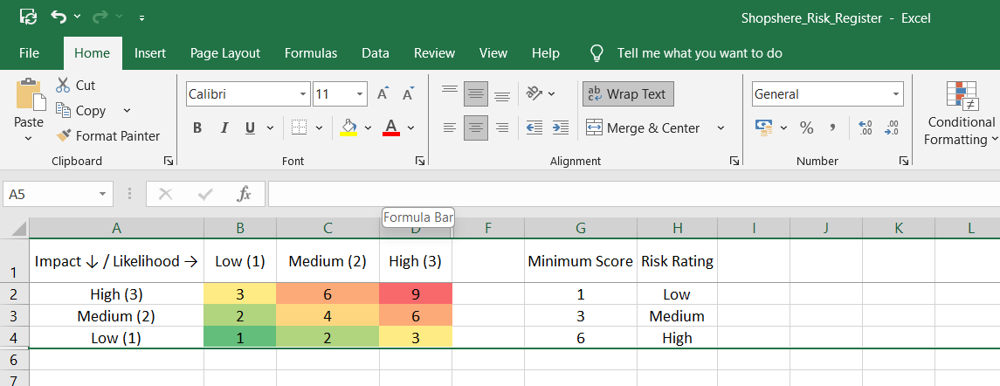
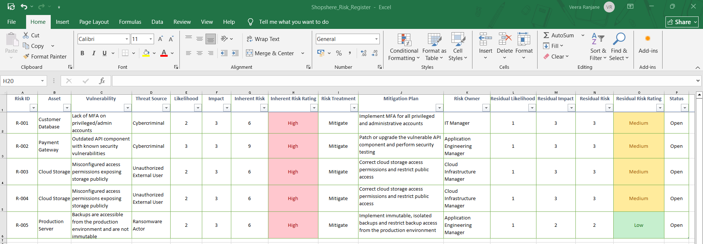
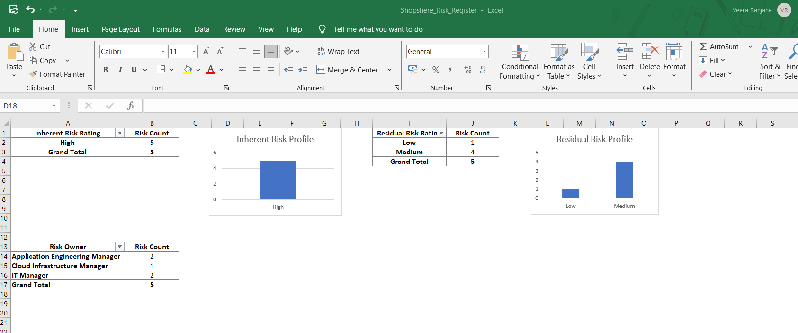

# ShopSphere GRC Risk Assessment

## Overview

This project demonstrates a qualitative cybersecurity risk assessment for **ShopSphere**, a simulated e-commerce environment.

The objective was to identify cybersecurity risks affecting key business assets, assess their inherent risk, determine appropriate risk treatments, and estimate residual risk after mitigation.

The assessment was developed in Microsoft Excel using a 3×3 qualitative risk matrix, VLOOKUP, conditional formatting, PivotTables, and PivotCharts.

> **Note:** ShopSphere is a simulated environment created for educational and portfolio purposes.

## Risk Assessment Methodology

Risk was assessed using:

**Risk Score = Likelihood × Impact**

Both Likelihood and Impact are rated on a 3-point scale:

| Rating | Likelihood | Impact |
|---|---|---|
| 1 | Low | Low |
| 2 | Medium | Medium |
| 3 | High | High |

Risk scores are classified as:

| Score | Risk Rating |
|---|---|
| 1–2 | Low |
| 3–4 | Medium |
| 6–9 | High |

## Risk Matrix

## Risks Assessed

Five cybersecurity risks were assessed across key ShopSphere assets:

- Customer Database — lack of MFA on privileged/admin accounts
- Payment Gateway — outdated API component with known vulnerabilities
- Cloud Storage — misconfigured access permissions
- Employee Laptop — delayed operating system and application patching
- Production Server — accessible and non-immutable backups

## Risk Register

The risk register documents:

- Asset
- Vulnerability
- Threat Source
- Likelihood and Impact
- Inherent Risk
- Risk Treatment
- Mitigation Plan
- Risk Owner
- Residual Likelihood
- Residual Impact
- Residual Risk
- Residual Risk Rating 
- Status

## Key Results

All five identified risks were initially assessed as **High inherent risk**.

Following the proposed mitigation measures:

- 4 risks were reduced to Medium
- 1 risk was reduced to Low
- 0 risks remained High

The assessment demonstrates how security controls can reduce risk while recognizing that some residual risk remains.

## Risk Dashboard

The dashboard uses PivotTables and PivotCharts to summarize the inherent and residual risk profile and risk ownership.

## Excel Skills Demonstrated

- Risk register development
- 3×3 qualitative risk matrix
- Likelihood and impact scoring
- Risk treatment and mitigation tracking
- Residual risk assessment
- VLOOKUP
- Conditional formatting
- Data validation dropdowns
- Excel Tables
- PivotTables
- PivotCharts
- Risk dashboard creation

## Disclaimer

This project is a simulated cybersecurity risk assessment created for learning and portfolio demonstration. The organization, risks, vulnerabilities, and assessment results do not represent a real company or production environment.
